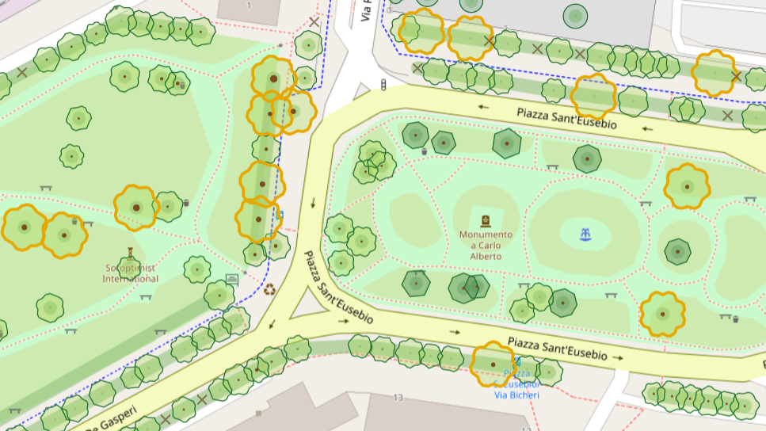

# DendrOSM 

Mappa degli alberi di OpenStreetMap (`natural=tree`, e i ceppi `natural=tree_stump`), divisa per regioni e pensata per il controllo di qualità dei dati.

**Sito**: https://ivanbranco.github.io/tree-osm-qa/

**Mappa degli alberi monumentali del mondo**: https://ivanbranco.github.io/tree-osm-qa/monumental-trees/

*OpenStreetMap e OSM sono marchi della OpenStreetMap Foundation. DendrOSM non è approvato dalla OpenStreetMap Foundation né affiliato a essa.*

## Cosa fa

* **Controlla i dati**: 48 check su misure, nomi di specie e generi, Wikidata, link e monumentali. Gli alberi con almeno un problema hanno il contorno rosso, e la scheda spiega ogni problema
* **Disegna gli alberi** con le loro misure reali: chioma, tronco, forma secondo il tipo di foglia, colore secondo il ciclo fogliare, e i monumentali, gli alberi sacri, i tronchi multipli, l'edera e i ceppi
* **Aiuta a correggere**: filtri per specie e per tipo di errore, scheda con foto e link, apertura dell'albero in iD, JOSM o MapComplete, download degli errori in GeoJSON
* **Confronta le regioni**: classifica degli errori, per numero o per percentuale, e andamento nel tempo
* **Mappa mondiale dei monumentali**: tutti gli alberi monumentali del mondo, senza la parte QA, da condividere
* In italiano e in inglese

## Regioni

Italia, Polonia, Francia metropolitana, Regno Unito e Irlanda (divisi in regioni), Austria (nei nove Länder); Portogallo, Lussemburgo, Paesi baltici, Slovenia, Croazia, Bosnia ed Erzegovina, Serbia, Montenegro, Kosovo, Albania, Macedonia del Nord, Grecia, Bulgaria, Romania, Giappone e lo stato di Washington (una regione ciascuno).

Una nuova regione si può chiedere dal menu («+ Richiedi una nuova regione…») o cliccando sulla mappa un paese non coperto. Si può anche chiedere una regione nuova o l'aggiornamento di una esistente aprendo una [issue su GitHub](https://github.com/ivanbranco/tree-osm-qa/issues/new?template=region.yml).

## Documentazione

* [Check QA](docs/check.md): tutti i controlli, con le soglie e da dove vengono
* [La mappa](docs/mappa.md): come sono disegnati gli alberi, filtri, scheda, classifica, andamento e lingua
* [Dati e aggiornamento](docs/dati.md): file dei dati, Action di aggiornamento, mappa mondiale e struttura del repository

Il sito è statico (GitHub Pages, MapLibre GL JS); i dati si scaricano da Overpass con le GitHub Action, lanciate a mano.

## Licenza e attribuzione

Dati e confini © contributori di [OpenStreetMap](https://www.openstreetmap.org/copyright), disponibili con licenza ODbL. Anche lo sfondo dell'immagine qui sopra è © contributori di OpenStreetMap.

Le liste di riferimento (`scripts/species_list.json` e `scripts/genus_list.json`) derivano dalle pagine [List of Species](https://wiki.openstreetmap.org/wiki/Tag:natural%3Dtree/List_of_Species) e [List of Genus, Leaf cycle, Leaf type](https://wiki.openstreetmap.org/wiki/Tag:natural%3Dtree/List_of_Genus,_Leaf_cycle,_Leaf_type) dell'OpenStreetMap Wiki, sotto licenza [CC BY-SA 2.0](https://wiki.openstreetmap.org/wiki/Wiki_content_license).

L'elenco dei codici e i dati degli alberi monumentali d'Italia (`scripts/masaf_list.json`, `scripts/masaf_trees.json`), usati per un check e per mostrare sulla mappa dei monumentali gli alberi non ancora su OpenStreetMap, derivano dall'elenco del MASAF, con licenza [CC BY 4.0](https://creativecommons.org/licenses/by/4.0/): Masaf - Direzione generale dell'economia montana e delle foreste - Difor4 - "dataset AMI - Censimento alberi monumentali d'Italia vs. 11_2024".
