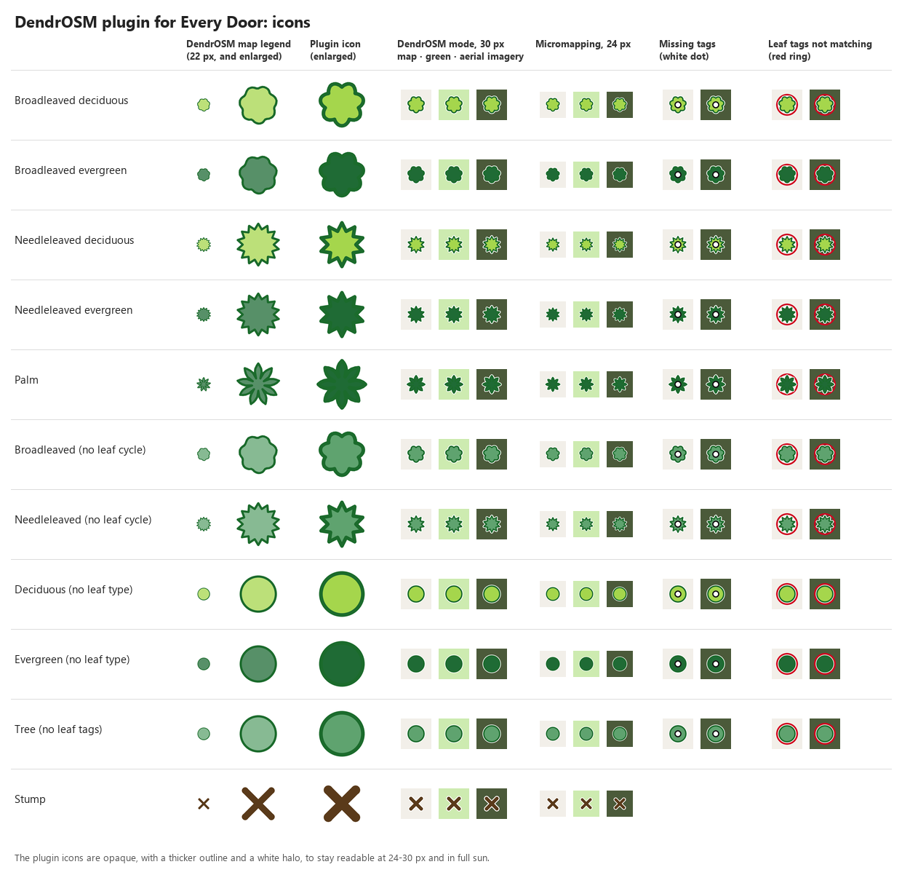

[← DendrOSM](../README.md)

# Every Door plugin

A plugin for [Every Door](https://every-door.app/), the Android and iOS editor for mapping OpenStreetMap on the ground. It adds trees with the species and the tags that follow from it, using the same reference lists as DendrOSM, and draws trees on the Every Door map with the crown legend of the DendrOSM map.

Written and tested with Every Door 7.1.

## Installing

Open this link on the phone, with Every Door installed:

https://plugins.every-door.app/i/dendrosm?url=https%3A%2F%2Fivanbranco.github.io%2Ftree-osm-qa%2Feverydoor%2Fdendrosm.edp

Or download [`dendrosm.edp`](https://ivanbranco.github.io/tree-osm-qa/everydoor/dendrosm.edp) and open it with Every Door. The plugin is then listed in "Settings → Plugins", where it can be disabled or deleted.

If the plugin cannot be enabled, the reason is in "Settings → About → System Log".

## Tree types

Every Door shows an object according to its type. With the plugin, the type of a tree is its leaf type and leaf cycle, and each type has the icon of the DendrOSM legend: the shape comes from the leaf type, the colour from the leaf cycle.

The type and the icon are decided in this order:

1. A palm: `leaf_type=palm`, or `taxon:family`, `family` or `taxon=Arecaceae`, `taxon:en=Palm`, `crown_type=I`, or a palm species of the species list. This counts more than the other leaf tags, as on the map
2. `leaf_type` and `leaf_cycle` both present: Broadleaved deciduous, Broadleaved evergreen, Needleleaved deciduous, Needleleaved evergreen
3. Otherwise the species, if it is in the [species list](https://wiki.openstreetmap.org/wiki/Tag:natural%3Dtree/List_of_Species), and then the genus, if it is in the [genus list](https://wiki.openstreetmap.org/wiki/Tag:natural%3Dtree/List_of_Genus,_Leaf_cycle,_Leaf_type): the tree gets the type that the list gives for it
4. Only `leaf_type`: Broadleaved or Needleleaved, with the colour of "Leaf cycle not specified". Only `leaf_cycle`: Deciduous or Evergreen, as a circle
5. None of these: the Tree type of Every Door, with a neutral circle

Stumps (`natural=tree_stump`) have their own type, with the X of the map.

Every Door compares values exactly as they are written: `species=Quercus ilex` is recognised, `species=quercus ilex` or a name with the author is not.

## Species and genera

All the species and genera of the two lists can be found from the type search (the + button of the micromapping mode, or the title of the editor of an existing tree), by scientific name or by common name in Italian and English. The common names come from Wikidata and are not reviewed: 595 species have an English one, 186 an Italian one. The synonyms of `scripts/whitelist.json` lead to the species too, for example `Platanus acerifolia` to `Platanus × hispanica`.

Choosing a species sets `natural=tree`, `species`, `species:wikidata`, `leaf_type` and `leaf_cycle`, with the values of the species list. Choosing a genus sets `natural=tree`, `genus`, `leaf_type`, and `leaf_cycle` only when it is the same for the whole genus. Other tags of the tree are kept.

On a tree that already has the species but not the tags that follow from it, choosing the same species again adds them.

When changing from a species to a genus, `species` and `species:wikidata` of the previous species remain and must be removed by hand. An existing `genus` is never changed.

## Modes

* **Micromapping** (the standard mode): trees and stumps have the icons above instead of coloured dots, and the legend names the types. Every Door counts a separate legend entry for each species or genus whose type is taken from the list, so the same type name can appear more than once, and it shows icons for at most six entries at a time: beyond that, objects are black dots
* **DendrOSM** (a new mode): shows only trees and stumps, to check them. Tapping a tree opens its editor. On top of the icon of the type:
  * a white dot: the tree has no `species` and lacks `leaf_type` or `leaf_cycle`. Any `species` value removes it, and so do the two leaf tags together
  * a red ring: `leaf_type` and `leaf_cycle` are both present but are not the ones of the species, or of the genus. For palms `leaf_type=palm` and `broadleaved` are both accepted

## How it is built

`everydoor/build_plugin.py` writes `everydoor/dendrosm.edp` from `scripts/species_list.json`, `scripts/genus_list.json`, the palm genera of `scripts/fetch_trees.py`, the synonyms of `scripts/whitelist.json` and the common names in `everydoor/names.json` (downloaded from Wikidata by `everydoor/fetch_names.py`). The version number in `everydoor/version.json` goes up by itself when the content of the plugin changes, so that Every Door updates an installed copy. With `--preview` it also redraws the image above.

The plugin has no code: Every Door 7.1 plugins are a configuration file, so wrong values cannot be fixed automatically. The red ring relies on how Every Door 7.1 reads nested conditions of element kinds (`WHEN_BUG` in the script).
